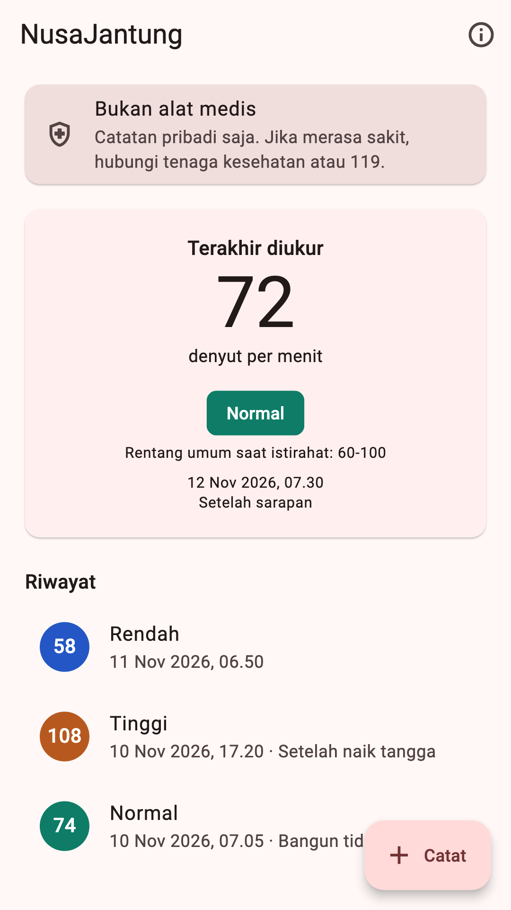
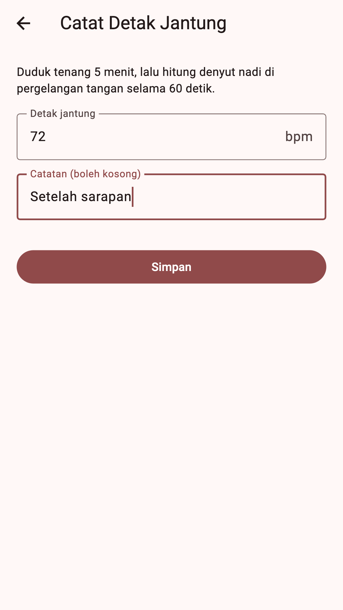
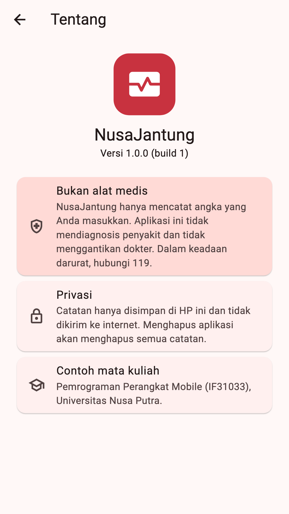

# NusaJantung — Sesi 15: Proyek Akhir dan Publikasi Aplikasi

Contoh aplikasi untuk mata kuliah **Pemrograman Perangkat Mobile (IF31033)**, Universitas Nusa Putra.

NusaJantung adalah catatan detak jantung harian: masukkan angka denyut per menit (bpm), lalu aplikasi menyimpannya beserta waktu dan menampilkan status Rendah, Normal, atau Tinggi. Aplikasinya sengaja kecil dan offline. Yang dipelajari adalah **cara menyiapkannya sampai siap diunggah ke Google Play**: identitas, ikon, izin, tanda tangan, dan file AAB.

> NusaJantung **bukan alat medis**. Batas 60-100 bpm adalah rentang umum orang dewasa saat istirahat, bukan diagnosis.

<p>



</p>

| Layar | Isi |
|---|---|
| Beranda | Peringatan "Bukan alat medis", catatan terakhir, riwayat (geser untuk hapus) |
| Catat Detak Jantung | Formulir bpm (30-220) dan catatan singkat |
| Tentang | Versi aplikasi (dibaca dari `pubspec.yaml`), peringatan medis, privasi |

## Menjalankan

```bash
flutter pub get
flutter run
flutter test        # 15 test: 10 unit test, 5 widget test
```

## Struktur folder

```
lib/
├── main.dart
├── app.dart
├── config/dependencies.dart
├── domain/
│   ├── heart_rate_rules.dart       # status Rendah/Normal/Tinggi + validasi bpm
│   └── models/heart_reading.dart
├── data/
│   ├── services/reading_storage.dart        # SharedPreferences, hanya di HP
│   └── repositories/reading_repository.dart
└── ui/
    ├── core/ (format.dart, status_color.dart)
    ├── home/ (home_page, home_screen, home_view_model)
    ├── add_reading/add_reading_screen.dart
    └── about/about_screen.dart
android/
├── key.properties.example          # contoh; key.properties asli TIDAK di-commit
└── app/
    ├── build.gradle.kts            # applicationId + signingConfigs
    └── src/main/AndroidManifest.xml  # nama aplikasi + izin
assets/icon/                        # gambar sumber ikon
store/                              # bahan Play Store: ikon 512, feature graphic, screenshot
PRIVACY.md                          # kebijakan privasi (URL-nya diisi di Play Console)
```

## Resep rilis 5 langkah

Setiap langkah ditandai komentar `RILIS langkah N` di file yang bersangkutan.

| Langkah | File | Isi |
|---|---|---|
| 1. Identitas | `pubspec.yaml`, `build.gradle.kts`, `AndroidManifest.xml` | `version: 1.0.0+1`, `applicationId = "id.ac.nusaputra.nusajantung"`, `android:label="NusaJantung"` |
| 2. Ikon | `pubspec.yaml` → `flutter_launcher_icons` | Satu gambar 1024×1024 menjadi ikon semua ukuran |
| 3. Izin | `AndroidManifest.xml` | Hanya izin yang fiturnya ada. NusaJantung tidak meminta izin apa pun |
| 4. Tanda tangan | `android/key.properties` + `build.gradle.kts` | Kunci upload dari `keytool`, file kunci tidak di-commit |
| 5. Bundle | terminal | `flutter build appbundle` → `app-release.aab` |

`version: 1.0.0+1` berarti **versionName** `1.0.0` (dilihat pengguna) dan **versionCode** `1` (nomor build). Setiap unggahan baru ke Play Console wajib memakai versionCode yang lebih besar, misalnya `1.0.1+2`.

## Langkah praktik

### Langkah 1 — Jalankan proyek

```bash
git clone https://github.com/Rifqi22424/publishing-flutter-app.git
cd publishing-flutter-app
flutter pub get
flutter test
flutter run
```

**Cek:** `flutter test` menampilkan `All tests passed!` (15 test), dan di aplikasi tampil kartu "Bukan alat medis".

### Langkah 2 — Identitas dan versi

Buka `pubspec.yaml`, `android/app/build.gradle.kts`, dan `android/app/src/main/AndroidManifest.xml`. Cari komentar `RILIS langkah 1`. Ubah versi menjadi `1.0.1+2`, lalu jalankan ulang aplikasi (stop, lalu `flutter run`; hot reload tidak cukup).

**Cek:** layar Tentang (ikon (i) di kanan atas) menampilkan `Versi 1.0.1 (build 2)`.

### Langkah 3 — Ikon aplikasi

Ganti `assets/icon/icon.png` (1024×1024) dan `assets/icon/icon_foreground.png` dengan gambar Anda sendiri, lalu:

```bash
dart run flutter_launcher_icons
```

**Cek:** keluarannya `✓ Successfully generated launcher icons`, file `android/app/src/main/res/mipmap-*/ic_launcher.png` berubah, dan ikon baru tampil di launcher emulator setelah aplikasi dipasang ulang.

### Langkah 4 — Kunci upload

Buat kunci upload **di luar folder proyek** (sekali saja, simpan baik-baik):

```bash
keytool -genkey -v -keystore ~/upload-keystore.jks -keyalg RSA \
        -storetype JKS -keysize 2048 -validity 10000 -alias upload
```

Salin `android/key.properties.example` menjadi `android/key.properties`, lalu isi password dan lokasi file `.jks`.

**Cek:** `git status` **tidak** menampilkan `key.properties` maupun file `.jks` (keduanya sudah ada di `android/.gitignore`).

### Langkah 5 — Build AAB

```bash
flutter build appbundle
keytool -printcert -jarfile build/app/outputs/bundle/release/app-release.aab
```

**Cek:** muncul `✓ Built build/app/outputs/bundle/release/app-release.aab`, dan `keytool -printcert` menampilkan nama (CN) yang Anda isi saat membuat kunci, bukan `Android Debug`.

### Langkah 6 — Play Console: internal testing

Jika punya akun Google Play Console: **Create app** → isi **Store listing** memakai file di folder `store/` dan teks di bawah → selesaikan **App content** (Privacy policy, Data safety, Content rating, Target audience, Health apps) → **Test and release › Testing › Internal testing › Create new release** → unggah `app-release.aab` → tambahkan email penguji.

**Cek:** rilis internal tersedia untuk penguji, dan penguji bisa membuka tautan undangan. Tanpa akun developer: centang semua baris Checklist rilis di bawah dan simpan AAB yang sudah ditandatangani.

## Bahan Store listing

| Kolom | Isi | Batas |
|---|---|---|
| Nama aplikasi | NusaJantung | 30 karakter |
| Deskripsi singkat | Catat detak jantung harian Anda. Offline, data hanya tersimpan di HP. | 80 karakter |
| Deskripsi lengkap | NusaJantung membantu Anda mencatat detak jantung saat istirahat. Masukkan angka denyut per menit, lalu lihat catatan terakhir, status sederhana (Rendah, Normal, Tinggi), dan riwayat. Semua data tersimpan di HP Anda dan tidak dikirim ke internet. NusaJantung bukan alat medis dan tidak menggantikan tenaga kesehatan. | 4000 karakter |
| Ikon | `store/icon_512.png` (512×512, PNG 32-bit) | maks. 1 MB |
| Feature graphic | `store/feature_graphic_1024x500.png` (PNG 24-bit, tanpa alpha) | 1024×500 |
| Screenshot HP | `store/store_phone_*.png` (1080×1920, rasio 9:16) | 2-8 per jenis perangkat |
| Kebijakan privasi | URL ke `PRIVACY.md` di repository ini | wajib untuk aplikasi kesehatan |
| Data safety | Tidak mengumpulkan dan tidak membagikan data (semua data tetap di HP) | |

## Checklist rilis

- [ ] `applicationId` bukan `com.example...` dan sudah final
- [ ] Nama aplikasi (`android:label`) dan ikon sudah diganti
- [ ] `version` dinaikkan untuk setiap unggahan
- [ ] Izin di `AndroidManifest.xml` hanya untuk fitur yang ada, dan alasannya bisa dijelaskan
- [ ] `key.properties` dan `.jks` tidak ada di GitHub, dan cadangannya disimpan aman
- [ ] `flutter analyze` bersih dan `flutter test` lulus
- [ ] `flutter build appbundle` berhasil, dan aplikasi dicoba sekali dengan `flutter run --release`
- [ ] Ikon 512, feature graphic, minimal 2 screenshot, dan URL kebijakan privasi siap

## Troubleshooting

| Masalah | Penyebab | Solusi |
|---|---|---|
| `Keystore file ... not found for signing config 'release'` | `storeFile` di `key.properties` salah | Pakai path lengkap, misalnya `/Users/nama/upload-keystore.jks` |
| `keystore password was incorrect` | Password di `key.properties` tidak sama dengan saat `keytool` | Periksa `storePassword` dan `keyPassword` |
| Play Console: version code sudah dipakai | versionCode sama dengan unggahan sebelumnya | Naikkan angka setelah `+` di `pubspec.yaml`, misalnya `1.0.0+2` |
| Play Console: AAB ditandatangani dengan kunci yang salah | Memakai kunci debug atau kunci lain | Pakai kunci upload yang didaftarkan; jika hilang, minta reset kunci upload di Play Console |
| Ikon tidak berubah di HP | Ikon lama tersimpan di launcher | Hapus aplikasi dari HP, lalu pasang ulang |
| `key.properties` ikut ter-push ke GitHub | File pernah di-commit sebelum masuk `.gitignore` | `git rm --cached android/key.properties`, lalu buat kunci upload baru |
